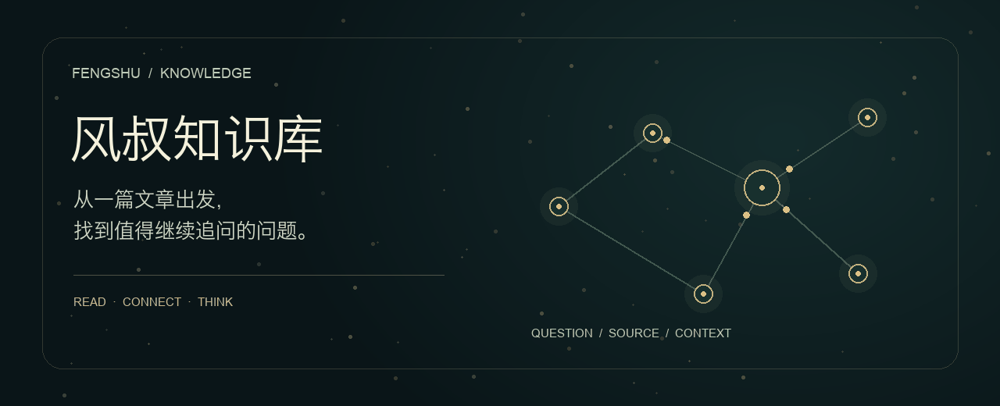

<div align="center">
  

  # 风叔知识库 · Fengshu Knowledge

  **从一篇文章出发，找到值得继续追问的问题。**

  一套围绕碧树西风（风叔）文章与思考方式的 AI Skill。<br>
  结合可选的知识库 MCP，让 AI 先找到材料、读懂上下文，再展开讨论。

  [开始使用](#开始使用) · [它能做什么](#它能做什么) · [skill--mcp](#skill--mcp) · [使用边界](#使用边界)
</div>

---

## 一个问题，如何找到有依据的回答？

> **你问：**「风叔怎么看待职场中的信息不对称？」
>
> **风叔知识库的工作方式：**先搜索相关文章 → 挑选不同角度的结果 → 必要时展开前后文 → 结合文章标题和日期整理观点。原文有公开链接时，附上链接供你继续阅读。

检索到的是材料，回答中的归纳仍需要判断。这个项目希望让你能回到文章本身，而不是只得到一个听起来像风叔的答案。

## 它能做什么

| 你想做的事 | 风叔知识库会怎么帮你 |
| --- | --- |
| **找文章** | 按主题、标题或短语查找相关文章，并整理来源。 |
| **理解观点** | 结合上下文解释观点，区分原文、整理和推断。 |
| **分析问题** | 从信息差、代理关系、长期目标等角度重新观察你的问题。 |
| **借鉴表达** | 参考具体场景和类比的表达方法，使用你自己的事实与经历写作。 |

试试这样提问：

- 「帮我找风叔关于信息不对称的文章，比较一下不同文章的侧重点。」
- 「用风叔文章中提到的思路，帮我分析是否转行；请说明哪些是你的推断。」
- 「我想写一篇关于职场选择的文章，用我的经历写得更有画面感。」

## Skill + MCP

```text
                   你提出的问题
                        │
               ┌────────▼────────┐
               │  Skill · 思考与写作 │
               │  路由问题 / 整理观点 │
               └────────┬────────┘
                        │ 可选
               ┌────────▼────────┐
               │  MCP · 检索与阅读  │
               │ 搜索 → 上下文 → 全文 │
               └────────┬────────┘
                        │
                文章来源与回答
```

**Skill** 是工作方法：告诉 AI 如何查找材料、使用框架和说明出处。本仓库自带少量本地参考资料，没有连接 MCP 也能使用，但覆盖范围有限。

**MCP** 是可选的检索接口：已有独立的风叔知识库实现，支持文章搜索、上下文展开和分页阅读。已有实例使用 Cloudflare AI Search 与 R2；它的文章和索引不包含在本仓库中，克隆本仓库不会自动创建或连接知识库。工具的实际可用性取决于你的 MCP 客户端及所连接的实例。

已有实例包含不同访问范围的材料；连接地址、身份验证和文章使用权限由实例运营者管理。请仅连接你获准使用的服务，也不要将私人或受限制的文章上传到公开仓库。

## 开始使用

### 安装 Skill

将仓库克隆到你的 Skill 目录。例如 macOS / Linux 下的 Codex：

```bash
mkdir -p ~/.codex/skills
git clone https://github.com/lucianwhy/fengshu-skill.git ~/.codex/skills/fengshu
```

WorkBuddy 用户可以按其当前 Skill 安装方式将仓库放入对应目录。安装后开启新对话，提出与风叔相关文章或思考方式有关的问题；支持显式调用的客户端也可以使用 `$fengshu`。触发和安装细节以具体客户端为准。

### 可选：连接知识库 MCP

在你的 AI 客户端中，按客户端文档配置**你有权使用的** Streamable HTTP MCP 地址。连接成功后，Skill 会优先使用可用的风叔知识库检索工具；没有连接时使用本地参考资料。不同客户端提供的工具版本可能不同，具体流程见 [SKILL.md](SKILL.md)。

### 本地素材

```text
SKILL.md                       Skill 入口和检索流程
references/frameworks.md       常见思考角度及局限
references/knowledge_base/     本地主题素材与索引
references/FENGSHU_STYLE_PROFILE.md   表达方式分析
scripts/                       原有的素材提取脚本与索引
assets/                        README 视觉素材
```

原有 `scripts/extract_knowledge.py` 面向本地 PDF/DOCX 素材，运行前需检查其中的路径与依赖；它不是在线抓取器或向量索引构建器。

## 使用边界

- 这是第三方整理的研究工具，不代表作者本人，也不表示获得作者背书。
- 整理出的框架是阅读线索，不应被当作作者在所有情境下的立场。对于找不到出处的观点，应明确说明。
- 原文和资料各有权利归属。本仓库的 MIT 许可不自动授予第三方文章的复制、分发或公开访问权。
- 项目中的本地素材、线上知识库和搜索结果可能不完整，也可能随时间变化。

## 致谢与许可

感谢碧树西风及其「记忆承载」「西风的罗盘」文章，也感谢 [女娲·Skill造人术](https://github.com/alchaincyf/nuwa-skill) 提供的早期方法参考。

项目代码和原创整理见 [MIT License](LICENSE)；第三方内容的权利另行处理。
