<div align="center">
  

  # Fengshu · 风叔知识库

  **让文章里的思考，成为可以继续对话的知识。**

  围绕公众号博主风叔（碧树西风）及「记忆承载」「西风的罗盘」文章构建的第三方 AI 知识项目。<br>
  用语义检索寻找线索，用上下文理解观点，让每一次讨论都能回到来源。

  `Semantic Retrieval` · `Context Expansion` · `Source Attribution` · `MCP`

  [了解项目](#从读过到随时找得到) · [开始使用](#开始使用) · [检索原理](#检索如何发生) · [MCP 接入](#连接知识库-mcp)
</div>

---

## 从「读过」到「随时找得到」

你可能记得风叔写过一个观点，却想不起文章标题；也可能找到了一句话，但不确定它在什么背景下成立。

Fengshu 希望把这种模糊的记忆变成清晰的阅读路径：**提出问题 → 找到文章 → 展开前后文 → 带着出处继续讨论。**

> **试着问：**「风叔关于信息不对称的文章，分别讨论了哪些问题？」
>
> 连接知识库后，AI 可以搜索不同角度的候选文章，读取命中片段的上下文，再按文章标题、日期和可用的原文链接整理答案。归纳和推断会与原文观点分开说明。

## 一个项目，两层能力

| 层次 | 负责什么 | 当前在哪里 |
| --- | --- | --- |
| **Skill · 研究与表达** | 选择检索路径、阅读材料、分析具体问题、整理有出处的回答 | 本仓库，可单独安装 |
| **MCP · 知识检索** | 搜索文章、合并多个查询、展开片段前后文、按需分页阅读 | 阿里云独立服务与 Cloudflare 备用服务 |

**本仓库是知识库的 AI 使用入口。** 它提供 Skill、阅读框架和本地参考资料；线上文章库、向量索引与服务端独立维护，不包含在本仓库中。安装 Skill 不会自动创建或连接线上知识库。

没有 MCP 时，仍可使用本地资料和分析框架；连接 MCP 后，才能调用独立知识库的检索能力。实际可读范围取决于所连接服务的授权。

## 你可以用它做什么

| 场景 | 可以这样提问 |
| --- | --- |
| **找回读过的文章** | 「记得风叔谈过稳定工作和长期选择，帮我找找相关文章。」 |
| **比较不同文章** | 「围绕信息不对称，整理几篇文章的共同点和差异，附出处。」 |
| **理解观点的条件** | 「这段话的前后文是什么？它讨论的是哪一种情况？」 |
| **分析自己的问题** | 「参考相关文章，帮我分析转行的取舍，把文章观点和你的推断分开。」 |
| **借鉴表达方法** | 「用我提供的经历写一段职场观察，参考具体场景和类比的表达方式。」 |

## 检索如何发生


MCP 先检索相关材料，再按需要补充阅读上下文，为 AI 的回答提供依据。目前提供两套独立部署：

| 部署 | 检索与存储 | 适用入口 |
| --- | --- | --- |
| **阿里云** | 本地 BGE 中文向量模型、关键词检索与 SQLite 原文库；当前包含 658 篇公开文章 | 默认公开入口，检索和阅读无需访问 `workers.dev` |
| **Cloudflare** | Workers + AI Search + R2 | 保留原认证服务作为备用 |

- **语义与关键词检索**：按含义寻找相关片段，也支持标题、短语和关键词匹配；`balanced`、`semantic`、`exact` 对应不同检索需求。
- **多角度查询与去重**：同一问题可以从 2～3 个角度搜索，按文章 ID 合并结果，减少重复文章占位。
- **片段级上下文展开**：搜索返回真实 `chunk_id` 和位置；可读取目标片段的前后文，必要时再分页阅读全文。
- **原文一致性校验**：从经过 SHA-256 校验的文章构建索引，保留真实片段位置；Cloudflare 版在上下文读取时也校验原文摘要。
- **来源追溯**：保留文章标题、日期及可用的公开链接；Skill 要求区分原文、归纳和推断。

这些能力帮助 AI 找到和理解材料，并不保证每个回答都正确。找不到可靠出处时，应直接说明。

### MCP 工具

| 工具 | 用途 |
| --- | --- |
| `search_fengshu_knowledge` | 单次主题、标题或短语检索 |
| `search_fengshu_knowledge_multi` | 多角度检索，跨查询合并去重 |
| `get_chunk_context` | 展开命中片段及其前后文 |
| `get_fengshu_article` | 必要时按偏移量分页阅读文章 |
| `get_fengshu_quota` | 查看当前网络地址剩余额度及恢复时间 |

推荐顺序：**先搜索 → 再读局部上下文 → 必要时阅读全文**。工具与参数以实际连接的实例为准，详细使用策略见 [SKILL.md](SKILL.md)。

## 开始使用

### 安装 Skill

支持 `SKILL.md` 的客户端可按自己的安装方式使用本仓库。例如安装到 Codex 的个人 Skill 目录：

```bash
mkdir -p ~/.codex/skills
git clone https://github.com/lucianwhy/fengshu-knowledge.git ~/.codex/skills/fengshu
```

安装后开启新对话，明确提出与风叔文章或思考方式有关的问题。支持显式调用的客户端可以使用 `$fengshu`。仓库名改为 `fengshu-knowledge`，Skill 的调用名仍是 `fengshu`。

WorkBuddy 等客户端请按其当前 Skill 安装方式放入相应目录；工具触发与 MCP 配置方式以客户端支持情况为准。

### 连接知识库 MCP

默认入口提供**免登录、免 Token** 的免费远程 MCP，使用 Streamable HTTP。

**给 Agent 配置的 MCP 地址：**

```text
https://fengshu.wanghaoyue.me/mcp
```

[查看接入说明与免费额度](https://fengshu.wanghaoyue.me/)

原 Cloudflare 认证入口继续保留：`https://fengshu-knowledge-free.2485855953.workers.dev/mcp`，仅该备用入口仍需 GitHub OAuth。两套服务独立运行、分别计量。

1. 在支持远程 MCP / Streamable HTTP 的 Agent 中添加上面的地址。
2. 鉴权选择「无」，不填写 Header、API Key 或 GitHub Token。
3. 连接后即可搜索文章、展开上下文；调用 `get_fengshu_quota` 查看剩余额度。

默认入口不再要求浏览器登录或 OAuth。曾经配置过旧凭证的客户端可删除该服务后按「无鉴权」重新添加；工具列表在会话开始时固定的客户端，需要重新连接或新开会话。客户端仍须实际支持 MCP；普通网页链接不会自动变成 AI 工具。

**默认入口按出口 IP 计量：每天 30 次检索、100 次阅读，每分钟最多 6 次工具调用。** 同一网络地址的所有 Agent 共用额度，换 Agent 名称不会重置；IPv6 按 /64 网段合并。共享网络的不同用户可能共用额度，换网络也可能获得不同额度，IP 不能精确识别个人。

全站每天最多 500 次、每月最多 10,000 次检索，每天最多 2,000 次阅读。每日额度于北京时间零点恢复。单查询计 1 次，多角度查询计 2～3 次；限制用于保护服务器资源。备用 Cloudflare 服务仍按 GitHub 账号和底层请求数计量。

服务免费，不提供充值或付费入口，只开放公开文章。详细规则见 [MCP 免费接入与额度说明](docs/mcp-access-plan.md)。

## 项目结构

```text
SKILL.md                             AI 使用入口与检索策略
references/frameworks.md             常见阅读角度及局限
references/knowledge_base/           本地主题资料与索引
references/FENGSHU_STYLE_PROFILE.md   表达方式分析
docs/mcp-access-plan.md              免费接入与额度管理
scripts/                            本地素材处理脚本
assets/                             SVG 与 GIF 视觉资源
```

原有 `scripts/extract_knowledge.py` 用于处理本地 PDF/DOCX 素材，运行前需检查路径和依赖；线上知识库的部署、文章同步和索引维护由独立服务完成。

## 项目进展

- **已提供**：可安装的 Skill、本地参考资料、免登录的阿里云 MCP、按 IP 共享的额度与全站上限；原 Cloudflare 认证版保持独立运行。
- **已验证**：无凭证调用全部 5 个工具、文章检索、上下文与分页阅读，以及更换 Agent 和伪造转发请求头不会重置当前 IP 的限流。
- **后续更新**：项目介绍文章发布后，在这里补充公众号原文链接。

<!-- 公众号文章正式发布后，将真实标题与 URL 添加到上面的项目进展中。 -->

## 使用边界

这是第三方整理的研究工具，不代表风叔本人，也不表示获得作者背书。整理的分析框架是阅读线索，不应被当作作者在所有情境下的立场。

文章与资料的权利属于各自权利人；项目的 MIT 许可不自动授予第三方文章的复制、分发或收费访问权。连接知识库时应遵守相应内容权限，受限材料不能因接入 MCP 而自动获得公开授权。

## 致谢与许可

感谢风叔（碧树西风）及「记忆承载」「西风的罗盘」的文章，也感谢 [女娲·Skill造人术](https://github.com/alchaincyf/nuwa-skill) 提供早期方法参考。

代码与原创整理见 [MIT License](LICENSE)；第三方内容的权利另行处理。
